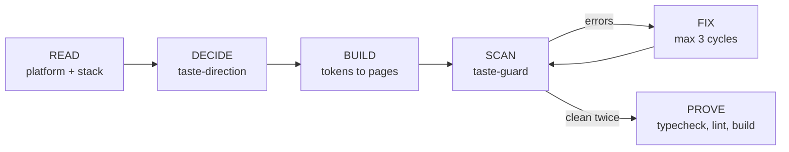

<p align="center">
  
</p>

<h1 align="center">Tastemaker</h1>

<p align="center"><b>The anti-slop design layer for AI coders.</b><br>
Stop Claude, Gemini, Lovable, Replit and Cursor from shipping purple gradients, emoji icons, "Unlock the power of..." copy and half-wired components.</p>

<p align="center">
  
  
  
  
  
</p>

---

## You know the look

Indigo-to-pink hero. Gradient headline. Three identical cards with an icon in a circle. "Trusted by 10,000+ happy customers." A rocket emoji. `outline-none` on every button. A "Get Started" that calls `() => {}`.

That is **AI slop**: the statistically likely answer, not the right one for your product. Tastemaker is a set of skills, a scanner and a feedback loop that make your coding agent decide like a senior product designer and check its own work before it says "done".

## Before and after (real scanner output)

```text
$ npx tastemaker scan tests/fixtures/sloppy
tastemaker scan · 1 files · score 0 (F) · 12 errors · 28 warnings · 3 info

tests/fixtures/sloppy/Landing.tsx
  9:62     warn   V01  Default "AI gradient"  "from-indigo-500 via-purple-500 to-pink-500"
  11:28    error  V07  Emoji in UI  "🚀"
  13:48    warn   C01  Hype copy  "Unlock"
  15:66    error  U03  Focus outline removed without replacement  "outline-none"
  15:81    error  E02  Empty event handler  "onClick={() => {}}"
  18:9     error  U01  Icon-only button without an accessible name
  31:29    error  E08  Placeholder image service  "placeholder.com"
  ...

$ npx tastemaker scan tests/fixtures/clean
tastemaker scan · 1 files · score 100 (A) · 0 errors · 0 warnings · 0 info
No slop found.
```

In Claude Code you never run this by hand: the plugin hook scans every file the agent writes and hands the errors straight back to it, so it fixes them in the same turn.

## Install in 30 seconds

| Where you build | How |
|---|---|
| **Claude Code** | `/plugin marketplace add Harrypatria/tastemaker` then `/plugin install tastemaker@tastemaker` |
| **Claude.ai** (Projects) | Paste [`dist/system-prompt.md`](dist/system-prompt.md) into Project instructions, or upload a skill folder from `skills/` |
| **Google AI Studio** | Paste [`dist/system-prompt.md`](dist/system-prompt.md) into System instructions (chat) or the app prompt (Build) |
| **Lovable** | Paste [`dist/lovable-knowledge.md`](dist/lovable-knowledge.md) into Project Knowledge |
| **Replit Agent** | `npx tastemaker init replit` (writes `replit.md`) |
| **Cursor** | `npx tastemaker init cursor` (writes `.cursor/rules/tastemaker.mdc`) |
| **Windsurf** | `npx tastemaker init windsurf` |
| **Codex, Jules, Aider** | `npx tastemaker init agents` (writes `AGENTS.md`) |
| **Gemini CLI** | `npx tastemaker init gemini` |
| **GitHub Copilot** | `npx tastemaker init copilot` |
| **Bolt, v0** | Paste [`dist/system-prompt.md`](dist/system-prompt.md) into project instructions |
| **CI** | `npx tastemaker scan src --project` (exits 1 on errors) |

Every platform prompt is generated from one source, [`adapters/core-prompt.md`](adapters/core-prompt.md), at about 1,300 tokens.

## What's inside

```
tastemaker/
├─ skills/
│  ├─ tastemaker/         router, taste contract, Taste Loop, slop catalog, platforms, stacks
│  ├─ taste-brief/        PRD or idea -> BUILD_MANIFEST.md (users, jobs, flows, states, data contracts)
│  ├─ taste-direction/    style, palette, type, layout, motion, charts, each with a reason
│  ├─ taste-tokens/       design-tokens.json -> tokens.css + Tailwind v4/v3 + shadcn, contrast-validated
│  ├─ taste-components/   shadcn/ui + Radix + Tailwind recipes, Portable Mode for .NET/Spring/air-gapped
│  ├─ taste-guard/        slop scanner, state matrix, a11y + compile trace, fix loop
│  ├─ taste-audit/        score and fix an existing UI, screenshot or URL
│  ├─ taste-brand/        positioning, voice, tone, messaging -> brand-guidelines.md
│  ├─ taste-identity/     original logo systems, favicons, app icons, collateral
│  ├─ taste-banners/      3 real art directions, platform safe zones, 2x PNG export
│  └─ taste-slides/       takeaway-title decks, Chart.js, notes, overview, print-to-PDF
├─ agents/taste-critic.md fresh-eyes reviewer (no builder bias)
├─ commands/              /tastemaker:build  :audit  :scan  :fix  :tokens
├─ hooks/hooks.json       scans every edited UI file, returns errors to the agent
├─ adapters/ + dist/      one prompt, nine platforms
└─ bin/tastemaker.mjs     CLI: scan, tokens, contrast, banners, init, prompt
```

### The skills

| Skill | Use it for | Writes |
|---|---|---|
| `tastemaker` | Any UI, brand, banner or deck request. Routes to the right skills in dependency order | (orchestrates) |
| `taste-brief` | "Build this app", pasted PRDs, one-line ideas | `BUILD_MANIFEST.md` |
| `taste-direction` | Choosing style, palette, fonts, layout, charts; "it looks generic" | 8-line Design Decision |
| `taste-tokens` | Design systems, themes, dark mode, Tailwind/shadcn wiring | `design-tokens.json`, `tokens.css`, `tailwind.v4.css`, `tailwind.v3.cjs` |
| `taste-components` | Building or restyling components, forms, tables, charts | components |
| `taste-guard` | After every build step; on hook feedback; "is this production ready" | fixes + status line |
| `taste-audit` | "Review my UI", "why does this look AI-made", pre-launch checks | scored P0/P1/P2 fix plan |
| `taste-brand` | Voice, tone, tagline, messaging, guidelines | `brand-guidelines.md` |
| `taste-identity` | Logos, favicons, app icons, letterhead, email signature | SVG logo system, icon set |
| `taste-banners` | OG images, social covers, ads, heroes, print | HTML artboards + PNG |
| `taste-slides` | Pitch, QBR, board, launch, training decks | single-file HTML deck + notes |

## The Taste Loop



1. **Decide before you draw.** The agent states an 8-line Design Decision (style, palette, type, layout, motion, charts, slop to avoid, audience risk), each line with a reason. You redirect in one message instead of after 400 lines of code.
2. **Tokens, not values.** One `design-tokens.json`; the builder refuses to emit tokens that fail WCAG contrast in light or dark.
3. **Every state exists.** Loading, empty, filtered-empty, error, success, permission-denied, plus hover, focus-visible, disabled and pending.
4. **Scan and fix.** 56 catalogued slop patterns, 48 detected automatically, fixed at the cause.
5. **Prove it.** Real typecheck, lint and build where tooling exists, and an honest status line: `Taste: 0 errors · 2 warnings · score 96 · BASIC 10/10 · build: passed`.

## The slop catalog

56 patterns with IDs, reasons and fixes in [`skills/tastemaker/references/slop-catalog.md`](skills/tastemaker/references/slop-catalog.md):

| Series | Examples |
|---|---|
| **V** Visual (18) | AI gradients, gradient text, glass cards, blurred blobs, neon glow, `hover:scale-105`, emoji icons, raw hex, sparkles-for-AI, palette classes instead of tokens, everything centered, template dashboards |
| **C** Copy (8) | unlock / supercharge / seamless, lorem and John Doe, invented social proof, "Get Started" / "Learn More", "Welcome to X", exclamation marks |
| **U** UX + a11y (15) | unnamed icon buttons, clickable divs, removed focus rings, placeholder-as-label, disabled zoom, `h-screen`, `alert()`, missing alt, missing states, color-only status |
| **E** Engineering (15) | TODOs, empty handlers, `any`, `!important`, `z-[9999]`, index keys, placeholder image services, two icon libraries, two component kits, wrong Tailwind major |

Keep a pattern on purpose by saying why: `// taste-ignore V01 gradient defined in brand-guidelines.md`.

## Token-efficient by design

Skills load in tiers so the agent only pays for what the task needs:

| Tier | Loaded | Size |
|---|---|---|
| Descriptions (all 11 skills) | always | ~1,200 tokens |
| Skill bodies for a typical UI build (router, direction, components, guard) | on trigger | ~3,200 tokens |
| References (palettes, recipes, catalog...) | only when a step needs them | 200-1,200 each |
| Scripts | executed, never read | 0 |

Every SKILL.md body has a hard budget of 1,800 tokens, enforced by `npm run check`.

## CLI

```bash
npx tastemaker scan src --project              # slop scan + stack checks, Taste score, exit 1 on errors
npx tastemaker scan src --json --fail-on warn  # CI-friendly
npx tastemaker tokens design-tokens.json --out src/styles --strict
npx tastemaker contrast "#ffffff" "#0F4C81"    # 8.86:1 AAA
npx tastemaker banners banners/                # 2x PNG export (needs Playwright)
npx tastemaker init cursor                     # drop the rules file into this project
npx tastemaker prompt lovable                  # print a paste-ready prompt
```

Configure with `.tastemakerrc.json`:

```json
{ "rules": { "V12": "off", "C06": "warn" }, "ignore": ["src/legacy/**"], "includeVendored": false }
```

Hook strictness: `TASTEMAKER_HOOK=block` (default: errors go back to the agent), `warn` (shown, not blocking) or `off`.

## Works with ui-ux-pro-max

Tastemaker extends rather than replaces lookup-style skills. If [ui-ux-pro-max](https://github.com/nextlevelbuilder/ui-ux-pro-max-skill) is installed, `taste-direction` may query its style and palette database for candidates; Tastemaker still makes the reasoned choice, and `taste-guard` still gates the result.

## FAQ

**Will it make every app look the same?** No. Tastemaker bans the defaults that make apps look the same. Palettes start from the domain (harbour blue for fintech, sage for wellness, vermilion for productivity), and layouts are derived from the user's top three questions, not from a template.

**Does the hook slow Claude down?** The scanner is a single zero-dependency Node file and checks only the edited file, typically in well under a second.

**Can I use only one skill?** Yes. Each skill folder is self-contained; copy it into `~/.claude/skills/`.

**Does it work without Tailwind or React?** Yes. Portable Mode covers Razor, Thymeleaf, Django, Rails and air-gapped deployments with plain HTML, precompiled CSS and vanilla modules.

## Contributing

New slop pattern? Add a catalog row, a scanner rule and a test. See [CONTRIBUTING.md](CONTRIBUTING.md). Run `npm run verify` before opening a pull request.

## License

MIT
