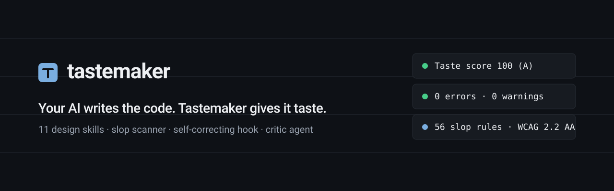
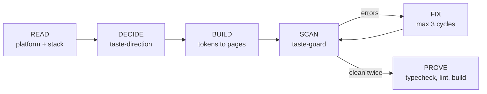

<p align="center">
  
</p>

<h1 align="center">Tastemaker</h1>

<p align="center">
  <b>The anti-slop design layer for AI coding agents.</b><br>
  Eleven agent skills, a zero-dependency scanner and a feedback loop that stop generated interfaces from shipping default gradients, emoji icons, hype copy and half-wired components.
</p>

<p align="center">
  <a href="LICENSE"></a>
  <a href="package.json"></a>
  
  
  
  
</p>

<p align="center">
  
  
  
  
  
  
  
</p>

<p align="center">
  <a href="https://github.com/Harrypatria/tastemaker/stargazers"></a>
  <a href="https://github.com/Harrypatria/tastemaker/issues"></a>
  <a href="https://github.com/Harrypatria/tastemaker/commits/main"></a>
  <a href="CONTRIBUTING.md"></a>
</p>

<!-- CI badge: add once the workflow file name is confirmed.
<a href="https://github.com/Harrypatria/tastemaker/actions">.yml?style=flat-square&label=CI"></a>
-->

<p align="center">
  <a href="#quick-start">Quick start</a> ·
  <a href="#install">Install</a> ·
  <a href="#skills">Skills</a> ·
  <a href="#the-taste-loop">Taste Loop</a> ·
  <a href="#shadcnui-integration">shadcn/ui</a> ·
  <a href="#cli-reference">CLI</a> ·
  <a href="#faq">FAQ</a> ·
  <a href="#contributing">Contributing</a>
</p>

---

## Table of contents

- [Overview](#overview)
- [Quick start](#quick-start)
- [Before and after](#before-and-after)
- [Install](#install)
- [Skills](#skills)
- [The Taste Loop](#the-taste-loop)
- [shadcn/ui integration](#shadcnui-integration)
- [The slop catalog](#the-slop-catalog)
- [Repository structure](#repository-structure)
- [Anatomy of a skill](#anatomy-of-a-skill)
- [Token budget](#token-budget)
- [CLI reference](#cli-reference)
- [Configuration](#configuration)
- [Continuous integration](#continuous-integration)
- [Accessibility and inclusion](#accessibility-and-inclusion)
- [Works with ui-ux-pro-max](#works-with-ui-ux-pro-max)
- [FAQ](#faq)
- [Contributing](#contributing)
- [License](#license)

---

## Overview

You know the look. An indigo-to-pink hero. A gradient headline. Three identical cards with an icon in a circle. "Trusted by 10,000+ happy customers." A rocket emoji. `outline-none` on every button. A "Get Started" button that calls `() => {}`.

That is **AI slop**: the statistically likely answer instead of the right one for your product. Coding agents produce it because it is the average of everything they have seen.

Tastemaker gives your agent three things it lacks by default:

1. **A decision process.** The agent states a design direction, with reasons, before it writes any markup.
2. **A set of constraints.** Design tokens, contrast checks and a catalog of 56 known slop patterns replace guesswork.
3. **A way to check its own work.** A scanner runs after every edit and returns errors to the agent, which fixes them in the same turn.

Tastemaker works with Claude Code, Claude.ai, Google AI Studio, Lovable, Replit, Cursor, Windsurf, Codex, Gemini CLI, GitHub Copilot, Bolt and v0. Every platform prompt comes from one source file.

## Quick start

**Claude Code** (full experience: skills, commands, sub-agent and hook):

```text
/plugin marketplace add Harrypatria/tastemaker
/plugin install tastemaker@tastemaker
```

**Any other agent or editor:**

```bash
npx tastemaker init cursor     # or: replit, windsurf, agents, gemini, copilot
```

**Scan an existing project right now:**

```bash
npx tastemaker scan src --project
```

No account, API key or configuration is required.

## Before and after

Output from the scanner against the repository's test fixtures:

```text
$ npx tastemaker scan tests/fixtures/sloppy
tastemaker scan · 1 files · score 0 (F) · 12 errors · 28 warnings · 3 info

tests/fixtures/sloppy/Landing.tsx
  9:62     warn   V01  Default "AI gradient"  "from-indigo-500 via-purple-500 to-pink-500"
  11:28    error  V07  Emoji in UI  "🚀"
  13:48    warn   C01  Hype copy  "Unlock"
  15:66    error  U03  Focus outline removed without replacement  "outline-none"
  15:81    error  E02  Empty event handler  "onClick={() => {}}"
  18:9     error  U01  Icon-only button without an accessible name
  31:29    error  E08  Placeholder image service  "placeholder.com"
  ...

$ npx tastemaker scan tests/fixtures/clean
tastemaker scan · 1 files · score 100 (A) · 0 errors · 0 warnings · 0 info
No slop found.
```

In Claude Code you do not run the scanner by hand. The plugin hook scans each file the agent writes and returns errors to the agent immediately.

## Install

Pick the row that matches where you build.

### Agent platforms

| Platform | Method | Result |
|---|---|---|
| **Claude Code** | `/plugin marketplace add Harrypatria/tastemaker`, then `/plugin install tastemaker@tastemaker` | Skills, slash commands, `taste-critic` agent and scan hook |
| **Claude.ai** (Projects) | Paste [`dist/system-prompt.md`](dist/system-prompt.md) into Project instructions, or upload a folder from `skills/` | Taste contract in every chat in the Project |
| **Google AI Studio** | Paste [`dist/system-prompt.md`](dist/system-prompt.md) into System instructions (chat) or the app prompt (Build) | Taste contract |
| **Lovable** | Paste [`dist/lovable-knowledge.md`](dist/lovable-knowledge.md) into Project Knowledge | Taste contract |
| **Bolt, v0** | Paste [`dist/system-prompt.md`](dist/system-prompt.md) into project instructions | Taste contract |

### Editors and CLI agents

| Platform | Command | File written |
|---|---|---|
| **Replit Agent** | `npx tastemaker init replit` | `replit.md` |
| **Cursor** | `npx tastemaker init cursor` | `.cursor/rules/tastemaker.mdc` |
| **Windsurf** | `npx tastemaker init windsurf` | Windsurf rules file |
| **Codex, Jules, Aider** | `npx tastemaker init agents` | `AGENTS.md` |
| **Gemini CLI** | `npx tastemaker init gemini` | Gemini context file |
| **GitHub Copilot** | `npx tastemaker init copilot` | Copilot instructions file |

### Pipelines

| Where | Command |
|---|---|
| **CI** | `npx tastemaker scan src --project` (exits 1 on errors) |

Every platform prompt is generated from one source, [`adapters/core-prompt.md`](adapters/core-prompt.md), at about 1,300 tokens. Print any of them with `npx tastemaker prompt <platform>`.

### Use a single skill

Each skill folder is self-contained. Copy one into `~/.claude/skills/` (or your project's `.claude/skills/`) and the agent loads it on trigger.

## Skills

Tastemaker ships 11 skills in [`skills/`](skills). The `tastemaker` router skill reads the request and calls the others in dependency order, so you can say "build this dashboard" and get brief, direction, tokens, components and guard in sequence.

| Skill | Use it for | Writes |
|---|---|---|
| [`tastemaker`](skills/tastemaker) | Any UI, brand, banner or deck request. Routes to the right skills in dependency order | (orchestrates) |
| [`taste-brief`](skills/taste-brief) | "Build this app", pasted PRDs, one-line ideas | `BUILD_MANIFEST.md` (users, jobs, flows, states, data contracts) |
| [`taste-direction`](skills/taste-direction) | Choosing style, palette, fonts, layout, motion, charts; "it looks generic" | 8-line Design Decision |
| [`taste-tokens`](skills/taste-tokens) | Design systems, themes, dark mode, Tailwind and shadcn wiring | `design-tokens.json`, `tokens.css`, `tailwind.v4.css`, `tailwind.v3.cjs` |
| [`taste-components`](skills/taste-components) | Building or restyling components, forms, tables, charts | Components (shadcn/ui, Radix, Tailwind; Portable Mode for other stacks) |
| [`taste-guard`](skills/taste-guard) | After every build step; on hook feedback; "is this production ready" | Fixes and a status line |
| [`taste-audit`](skills/taste-audit) | "Review my UI", "why does this look AI-made", pre-launch checks | Scored P0, P1 and P2 fix plan |
| [`taste-brand`](skills/taste-brand) | Positioning, voice, tone, tagline, messaging | `brand-guidelines.md` |
| [`taste-identity`](skills/taste-identity) | Logos, favicons, app icons, letterhead, email signature | SVG logo system, icon set |
| [`taste-banners`](skills/taste-banners) | OG images, social covers, ads, heroes, print | HTML artboards and 2x PNG |
| [`taste-slides`](skills/taste-slides) | Pitch, QBR, board, launch and training decks | Single-file HTML deck with notes, overview and print-to-PDF |

### Commands and agents

| Item | Purpose |
|---|---|
| `/tastemaker:build` | Run the full pipeline for a new UI |
| `/tastemaker:audit` | Score and plan fixes for an existing UI |
| `/tastemaker:scan` | Run the scanner on the current project |
| `/tastemaker:fix` | Fix scanner findings at the cause |
| `/tastemaker:tokens` | Generate and validate design tokens |
| [`agents/taste-critic.md`](agents/taste-critic.md) | A reviewer with fresh context and no attachment to the builder's choices |

## The Taste Loop



| Step | What happens |
|---|---|
| **Read** | The agent detects the platform and stack (Tailwind major version, component kit, icon library) before it chooses anything. |
| **Decide** | The agent states an 8-line Design Decision covering style, palette, type, layout, motion, charts, slop to avoid and audience risk. Each line carries a reason. You redirect in one message instead of after 400 lines of code. |
| **Build** | One `design-tokens.json` drives the build. The token builder refuses to emit colors that fail WCAG contrast in light or dark mode. |
| **Scan** | `taste-guard` runs the scanner and checks that every state exists: loading, empty, filtered-empty, error, success, permission-denied, plus hover, focus-visible, disabled and pending. |
| **Fix** | Findings get fixed at the cause, for a maximum of 3 cycles. |
| **Prove** | The agent runs the real typecheck, lint and build where tooling exists, then reports an honest status line. |

Example status line:

```text
Taste: 0 errors · 2 warnings · score 96 · BASIC 10/10 · build: passed
```

## shadcn/ui integration

Tastemaker treats shadcn/ui as the default component foundation for React projects, and keeps the result from looking like a stock shadcn install.

| Layer | What Tastemaker does |
|---|---|
| **Tokens** | `taste-tokens` maps `design-tokens.json` to the shadcn CSS variable contract (`--background`, `--foreground`, `--primary`, `--muted`, `--accent`, `--destructive`, `--border`, `--ring` and the rest), with light and dark values validated for contrast. |
| **Tailwind** | Output targets both Tailwind v4 (`tailwind.v4.css`, CSS-first `@theme`) and v3 (`tailwind.v3.cjs`). The scanner flags a mismatch between the installed major version and the syntax in your code. |
| **Components** | `taste-components` supplies recipes built on shadcn/ui, Radix primitives and Tailwind utilities, so keyboard handling, focus management and ARIA come from the primitive instead of hand-written `div` elements. |
| **Variants** | Recipes extend shadcn components through variants and tokens instead of one-off class strings, which keeps the design system in one place. |
| **One kit, one icon set** | The scanner reports a second component kit or a second icon library in the same project. |
| **No shadcn, no problem** | [Portable Mode](#faq) covers stacks where React, Tailwind or a build step is not an option. |

Typical flow in a shadcn project:

```bash
npx tastemaker tokens design-tokens.json --out src/styles --strict
npx tastemaker scan src --project
```

Then ask your agent to build with `taste-components`. It reuses the components in your `components/ui` folder and restyles them through tokens.

## The slop catalog

56 patterns, each with an ID, a reason and a fix. The full list lives in [`skills/tastemaker/references/slop-catalog.md`](skills/tastemaker/references/slop-catalog.md). The scanner detects 48 of them automatically.

| Series | Count | Examples |
|---|---|---|
| **V** Visual | 18 | AI gradients, gradient text, glass cards, blurred blobs, neon glow, `hover:scale-105`, emoji used as icons, raw hex values, sparkles-for-AI, palette classes instead of tokens, everything centered, template dashboards |
| **C** Copy | 8 | "unlock", "supercharge", "seamless", lorem ipsum and John Doe, invented social proof, "Get Started" and "Learn More", "Welcome to X", exclamation marks |
| **U** UX and accessibility | 15 | unnamed icon buttons, clickable `div` elements, removed focus rings, placeholder-as-label, disabled zoom, `h-screen`, `alert()`, missing alt text, missing states, status shown by color alone |
| **E** Engineering | 15 | TODOs, empty handlers, `any`, `!important`, `z-[9999]`, array index as key, placeholder image services, two icon libraries, two component kits, wrong Tailwind major version |

Keep a pattern on purpose by saying why:

```tsx
// taste-ignore V01 gradient defined in brand-guidelines.md
```

## Repository structure

```text
tastemaker/
├─ .claude-plugin/          plugin and marketplace manifests for Claude Code
├─ .github/workflows/       CI
├─ adapters/                core-prompt.md, the single source for every platform prompt
├─ agents/                  taste-critic.md, the fresh-eyes reviewer
├─ assets/                  banner and brand images
├─ bin/
│  └─ tastemaker.mjs        CLI: scan, tokens, contrast, banners, init, prompt
├─ commands/                /tastemaker:build, :audit, :scan, :fix, :tokens
├─ dist/                    generated prompts: system-prompt.md, lovable-knowledge.md, ...
├─ hooks/
│  └─ hooks.json            scans each edited UI file and returns errors to the agent
├─ scripts/                 build and check scripts (prompt generation, token budget)
├─ skills/
│  ├─ tastemaker/           router, taste contract, Taste Loop, slop catalog, platforms, stacks
│  ├─ taste-brief/          PRD or idea to BUILD_MANIFEST.md
│  ├─ taste-direction/      style, palette, type, layout, motion, charts
│  ├─ taste-tokens/         design-tokens.json to CSS, Tailwind v4/v3 and shadcn
│  ├─ taste-components/     shadcn/ui, Radix and Tailwind recipes, Portable Mode
│  ├─ taste-guard/          scanner, state matrix, accessibility and compile trace
│  ├─ taste-audit/          score and fix an existing UI
│  ├─ taste-brand/          positioning, voice, tone, messaging
│  ├─ taste-identity/       logo systems, favicons, app icons, collateral
│  ├─ taste-banners/        art directions, safe zones, 2x PNG export
│  └─ taste-slides/         takeaway-title decks and print-to-PDF
├─ tests/                   fixtures (sloppy, clean) and rule tests
├─ CHANGELOG.md
├─ CONTRIBUTING.md
├─ LICENSE
└─ package.json
```

## Anatomy of a skill

Each skill follows the Agent Skills layout: a folder with a `SKILL.md` file at its root and optional supporting folders.

```text
skills/taste-tokens/
├─ SKILL.md          frontmatter (name, description) plus the instructions
├─ references/       loaded only when a step needs them
└─ scripts/          executed by the agent, never read into context
```

`SKILL.md` starts with YAML frontmatter. The `description` tells the agent when to trigger the skill, so it states the user intents the skill covers.

```markdown
---
name: taste-tokens
description: Build or revise a design system, theme or dark mode, and wire it to Tailwind and shadcn/ui with contrast-validated tokens.
---

# Taste Tokens

Instructions the agent follows once the skill triggers.
```

Rules that apply to every skill in this repository:

- The body of each `SKILL.md` stays under **1,800 tokens**. `npm run check` enforces the limit.
- Long material (palettes, recipes, the slop catalog) lives in `references/` and loads on demand.
- Deterministic work (scanning, token generation, contrast math, PNG export) lives in `scripts/` or `bin/` so the agent runs it instead of reasoning about it.
- A skill declares what it writes, so you know which files to expect.

## Token budget

Skills load in tiers, so the agent pays only for what a task needs.

| Tier | Loaded | Size |
|---|---|---|
| Descriptions of all 11 skills | Always | about 1,200 tokens |
| Skill bodies for a typical UI build (router, direction, components, guard) | On trigger | about 3,200 tokens |
| References (palettes, recipes, catalog) | When a step needs them | 200 to 1,200 tokens each |
| Scripts | Executed, never read | 0 tokens |

## CLI reference

```bash
npx tastemaker scan src --project              # slop scan plus stack checks, Taste score, exit 1 on errors
npx tastemaker scan src --json --fail-on warn  # machine-readable output, stricter gate
npx tastemaker tokens design-tokens.json --out src/styles --strict
npx tastemaker contrast "#ffffff" "#0F4C81"    # 8.86:1 AAA
npx tastemaker banners banners/                # 2x PNG export (needs Playwright)
npx tastemaker init cursor                     # write the rules file for an editor or agent
npx tastemaker prompt lovable                  # print a paste-ready prompt
```

| Command | Purpose |
|---|---|
| `scan <path>` | Detect slop patterns, report a Taste score from 0 to 100 with a letter grade |
| `tokens <file>` | Build CSS, Tailwind and shadcn output from a token file; `--strict` fails on contrast violations |
| `contrast <fg> <bg>` | Report the WCAG contrast ratio and conformance level for two colors |
| `banners <dir>` | Export HTML artboards to 2x PNG |
| `init <platform>` | Write the rules file for a platform into the current project |
| `prompt <platform>` | Print the generated prompt for a platform |

## Configuration

Create `.tastemakerrc.json` in your project root:

```json
{
  "rules": { "V12": "off", "C06": "warn" },
  "ignore": ["src/legacy/**"],
  "includeVendored": false
}
```

| Key | Type | Purpose |
|---|---|---|
| `rules` | object | Set a rule ID to `"off"`, `"warn"` or `"error"` |
| `ignore` | string array | Glob patterns the scanner skips |
| `includeVendored` | boolean | Scan vendored code such as `components/ui` |

**Hook strictness** uses the `TASTEMAKER_HOOK` environment variable:

| Value | Behavior |
|---|---|
| `block` (default) | Errors return to the agent, which fixes them before continuing |
| `warn` | Findings display but do not block |
| `off` | The hook does nothing |

## Continuous integration

Gate pull requests on the same checks your agent runs locally.

```yaml
name: taste
on: [pull_request]
jobs:
  scan:
    runs-on: ubuntu-latest
    steps:
      - uses: actions/checkout@v4
      - uses: actions/setup-node@v4
        with:
          node-version: 20
      - run: npx tastemaker scan src --project --fail-on warn
```

## Accessibility and inclusion

Tastemaker treats accessibility as a build constraint. Contributions and documentation follow the same standard.

- **WCAG 2.2 AA is the floor.** Token generation fails on insufficient contrast in light or dark mode. The scanner checks accessible names, focus visibility, labels, alt text, zoom, and status conveyed by color alone.
- **Every state is designed.** Loading, empty, error and permission-denied screens are part of the contract, because those are the states real users hit.
- **Stack-agnostic by design.** Portable Mode produces plain HTML, precompiled CSS and vanilla modules for Razor, Thymeleaf, Django, Rails and air-gapped deployments, so teams outside the React and Tailwind ecosystem get the same checks.
- **Agent-agnostic by design.** Nine platforms share one source prompt, so no tool is a second-class citizen.
- **Copy rules favor plain language.** The copy series flags hype words, invented testimonials and filler, and pushes toward specific, readable text.
- **Documentation conventions.** Images carry alt text, headings follow a logical order, and examples avoid idioms that translate poorly. Pull requests that improve clarity, translations or accessibility of these docs are welcome.

## Works with ui-ux-pro-max

Tastemaker extends lookup-style skills and leaves them in place. If [ui-ux-pro-max](https://github.com/nextlevelbuilder/ui-ux-pro-max-skill) is installed, `taste-direction` can query its style and palette database for candidates. Tastemaker still makes the reasoned choice, and `taste-guard` still gates the result.

## FAQ

**Will every app look the same?**
No. Tastemaker bans the defaults that make apps look alike. Palettes start from the domain (harbour blue for fintech, sage for wellness, vermilion for productivity), and layouts derive from the user's top three questions instead of a template.

**Does the hook slow my agent down?**
The scanner is a single zero-dependency Node file that checks only the edited file, usually in well under a second.

**Can I use one skill instead of all eleven?**
Yes. Each skill folder is self-contained. Copy it into `~/.claude/skills/`.

**Does it work without Tailwind or React?**
Yes. Portable Mode covers Razor, Thymeleaf, Django, Rails and air-gapped deployments with plain HTML, precompiled CSS and vanilla modules.

**Does it need network access or an API key?**
No. The scanner and token builder run locally. Banner PNG export needs Playwright.

**Can I override a rule?**
Yes. Turn it off in `.tastemakerrc.json`, or keep one instance with a `taste-ignore` comment that states the reason.

## Contributing

Contributions are welcome from people of every background and experience level.

- **New slop pattern:** add a catalog row, a scanner rule and a test.
- **New platform adapter:** extend `adapters/` and regenerate `dist/`.
- **Documentation:** fixes, clearer wording, translations and accessibility improvements.

Read [CONTRIBUTING.md](CONTRIBUTING.md) first, then run `npm run verify` before you open a pull request. Release notes live in [CHANGELOG.md](CHANGELOG.md).

## License

Released under the [MIT License](LICENSE).